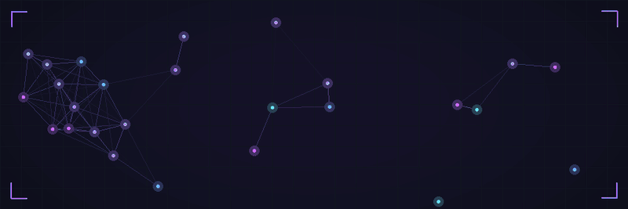

<div align="center">



**[LinkedIn](https://www.linkedin.com/in/sahil-verma-b40b38385)** · **[X](https://x.com/SahilVerma549)** · **[Email](mailto:sahilvermai5948@gmail.com)** · **[GitHub](https://github.com/sahilcodes216)**

</div>

<br>

> [!NOTE]
> 👋 **Welcome to my corner of GitHub!** I'm learning in public, building small projects and getting better one commit at a time.

<br>

## 🖥️ whoami

```bash
sahil@github:~$ whoami

  👤 Name        Sahil Verma
  🎓 Degree      B.Tech CSE (AI & ML)
  🏫 University  Amity University Jharkhand
  🔭 Exploring   Artificial Intelligence · Machine Learning · Programming
  🌱 Learning    Python for ML · Data Structures & Algorithms
  🎯 Goal        Turn curiosity into real-world AI projects
  💬 Ask me      Python, C/C++, HTML, getting started with AI
  🤝 Open to     Collaborating on beginner-friendly AI/ML & web projects

sahil@github:~$ _
```

<br>

## ⚡ Skills

```text
Python       ████████░░   Comfortable
C / C++      ███████░░░   Comfortable
HTML         ███████░░░   Comfortable
Bootstrap    ██████░░░░   Getting there
ML Basics    ████░░░░░░   Learning
DSA          ████░░░░░░   Learning
```

> *Bars show my own comfort level, not an exam score. They fill up as I keep building.*

<div align="center">

`Python` &nbsp; `C` &nbsp; `C++` &nbsp; `HTML5` &nbsp; `Bootstrap` &nbsp; `Git` &nbsp; `GitHub` &nbsp; `VS Code` &nbsp; `Jupyter`

</div>

<br>

## 🚀 Projects

<details open>
<summary><b>📂 Project One</b> &nbsp;·&nbsp; <code>Python</code></summary>

<br>

One or two lines about what it does and why you built it.

🔗 **[View on GitHub](https://github.com/sahilcodes216)**

</details>

<details>
<summary><b>📂 Project Two</b> &nbsp;·&nbsp; <code>HTML</code> <code>Bootstrap</code></summary>

<br>

One or two lines about what it does and why you built it.

🔗 **[View on GitHub](https://github.com/sahilcodes216)**

</details>

<details>
<summary><b>📂 Project Three</b> &nbsp;·&nbsp; <code>C++</code></summary>

<br>

One or two lines about what it does and why you built it.

🔗 **[View on GitHub](https://github.com/sahilcodes216)**

</details>

<br>

## 🗺️ Roadmap

```text
 ✅ Programming basics (C, C++, Python)
  │
 ✅ First small projects
  │
 🔄 Data Structures & Algorithms          ← I am here
  │
 ⬜ ML libraries (NumPy, Pandas, Scikit-learn)
  │
 ⬜ End-to-end ML project, deployed
  │
 ⬜ Open source contributions
```

<br>

## 📬 Let's Connect

| | |
|:--|:--|
| 💼 **LinkedIn** | [sahil-verma](https://www.linkedin.com/in/sahil-verma-b40b38385) |
| 🐦 **X** | [@SahilVerma549](https://x.com/SahilVerma549) |
| 📧 **Email** | [sahilvermai5948@gmail.com](mailto:sahilvermai5948@gmail.com) |

<br>

<div align="center">

```
╔══════════════════════════════════════════════╗
║   "The best way to learn is to build."       ║
╚══════════════════════════════════════════════╝
```

⭐ **Like what you see? Star a repo and say hi!** ⭐

</div>
